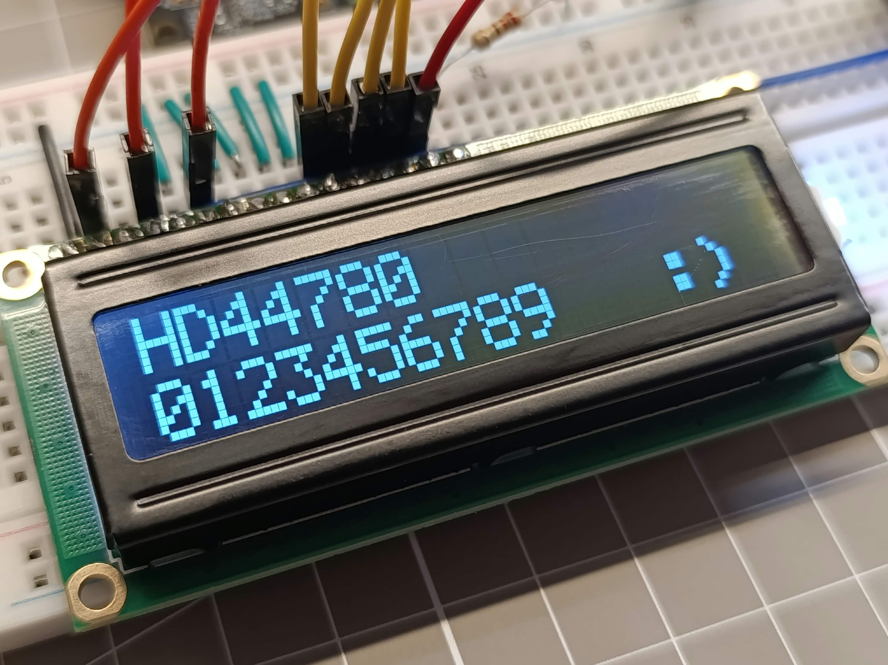
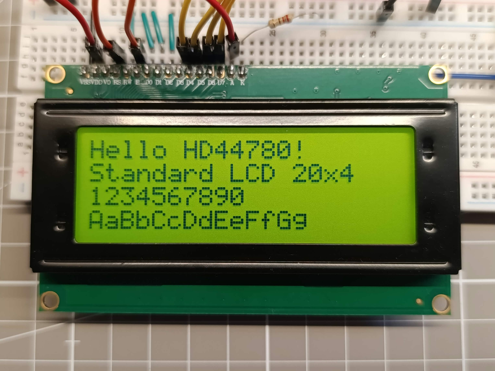

# HD44780 Driver

<p align="center">
  
  
</p>

A portable C driver for character LCDs using an **HD44780-compatible controller**. It uses a 4-bit, write-only interface; GPIO access and timing are supplied by the application through a small Hardware Abstraction Layer (HAL).


***Project status:** This is an initial version of the driver. The current API covers basic LCD initialization, cursor positioning, display clearing, and text output. Additional features and API improvements may be introduced in future releases.*


> **Version:** 1.0 [(see more in table below)](#version-history)

## Contents

-   [Features and limitations](#Features-and-limitations)
-   [Repository Structure](#repository-structure)
-   [Wiring](#wiring)
-   [Quick Start](#quick-start)
-   [Platform Abstraction (HAL)](#platform-abstraction-hal)
-   [API Reference](#api-reference)
-   [Configuration and instance state](#configuration-and-instance-state)
-   [Return Status Codes](#return-status-codes)
-   [Version History](#version-history)
-   [License](#license)


## Features and limitations

- 4-bit interface and configurable row/column count.
- Configurable GPIO pin mapping.
- Configurable cursor visibility and blinking.
- HAL callbacks for GPIO writes and blocking microsecond delays.
- Display initialization, clearing, cursor positioning, return-home, and null-terminated string output.

The driver is intended for common HD44780-compatible displays such as 16×2 and 20×4 modules. Note the following limitations:

- Operations are blocking; text does not automatically wrap to the next line.
- Custom characters in CGRAM are not (yet) supported.
- DDRAM address mapping may vary between modules.
- Support for modules with multiple controllers (including some 40×4 displays) is not guaranteed.

The repository also contains platform-specific support for NXP FRDM-MCXA153 and MCXN947 boards.

## Repository structure

The portable driver consists of `HD44780.h` and `HD44780.c`. Platform-specific HAL code and examples are kept separately.

```
.
├── HD44780.h
├── HD44780.c 
├── examples/
├── images/
└── wiring-examples/
```

## Wiring

GPIO ports and pin numbers are not hard-coded. Supply the six signal pin identifiers in `hd44780_Config_t.pins`, in this order:

| Array index | LCD signal |
|---|---|
| `HD44780_RS` | RS |
| `HD44780_E` | E |
| `HD44780_D4` | D4 |
| `HD44780_D5` | D5 |
| `HD44780_D6` | D6 |
| `HD44780_D7` | D7 |


The driver uses a configurable pin mapping, allowing it to work with different microcontrollers and GPIO configurations. Connect the LCD in 4-bit mode and check the display module's pinout before powering it.

Example wiring diagrams: `wiring-examples/`

## Quick start

This is an illustrative example. Replace the pin identifiers and `context` with values appropriate for your board. Initialize the MCU clocks and GPIO before calling `HD44780_InitInstance()`.

```c
#include "HD44780.h"
#include "nxp_hal.h"

/* It is very important to initialize the instance with zeros before the first use. */
static hd44780_t lcd = {0};

static const hd44780_Config_t lcdConfig = {
    .rows = 4,
    .cols = 20,
    .cursorShow = 0,
    .cursorBlink = 0,
    .pins = {
        /* Pin values are placeholders and must be replaced with valid */
        [HD44780_RS] = 0,
        [HD44780_E]  = 1,
        [HD44780_D4] = 2,
        [HD44780_D5] = 3,
        [HD44780_D6] = 4,
        [HD44780_D7] = 5
    },
    .hal = {
        .write_pin = nxp_write_pin,
        .delay_us = nxp_delay_us
    },
    .context = GPIO3
};

int main(void)
{
    /* Initialize clocks and GPIO first. */

    if (HD44780_InitInstance(&lcd, &lcdConfig) != HD44780_OK) {
        /* Handle initialization failure. */
        while (1) {}
    }

    HD44780_PrintOnDisplay(&lcd, "Hello, world!");
    HD44780_SetCursor(&lcd, 1, 0);
    HD44780_PrintOnDisplay(&lcd, "HD44780 driver");

    while (1) {
        /* Application code. */
    }
}
```

**The pin values above are placeholders and must be replaced with valid**, distinct identifiers for the selected HAL. The example assumes `GPIO3` and the `nxp_*` callbacks exist in the project; these names are platform-specific.

## Platform Abstraction (HAL)

The configuration requires two callbacks:

```c
void write_pin(void *context, uint8_t pin, uint8_t state);
void delay_us(uint32_t us);
```

| Callback | Contract |
|---|---|
| `write_pin` | Set the pin identified by `pin` to `state` (`0` or `1`). `context` is passed through to the HAL, for example as a GPIO-port pointer. |
| `delay_us` | Provide a blocking delay of at least the requested number of microseconds. |

The driver checks that both callbacks are non-`NULL`, but does not validate `context`; `NULL` may be valid on some platforms. The HAL implementation is responsible for interpreting `context` and handling invalid platform-specific values.

Example for an NXP SDK:

```c
void nxp_write_pin(void *context, uint8_t pin, uint8_t state)
{
    GPIO_Type *gpio = (GPIO_Type *)context;
    if (gpio == NULL) {
        return;
    }
    GPIO_PinWrite(gpio, pin, state);
}

void nxp_delay_us(uint32_t us)
{
    SDK_DelayAtLeastUs(us, SDK_DEVICE_MAXIMUM_CPU_CLOCK_FREQUENCY);
}
```

## API reference

All public functions return `hd44780_status_t`.

| Function | Description |
|---|---|
| `HD44780_InitInstance(lcd, config)` | Validates the configuration and initializes the LCD, including the startup reset sequence and 4-bit mode setup. Startup includes an approximately 50 ms delay. |
| `HD44780_DeInit(lcd)` | Sends display-off and marks the instance uninitialized. |
| `HD44780_ClearDisplay(lcd)` | Clears the display and returns the cursor to the home position. |
| `HD44780_ReturnHome(lcd)` | Returns the cursor to home without clearing the display. |
| `HD44780_SetCursor(lcd, row, col)` | Sets the cursor position. `row` and `col` are zero-indexed. Out-of-range values return `HD44780_ERROR_ARGUMENT`. |
| `HD44780_PrintOnDisplay(lcd, s)` | Writes a null-terminated string from the current cursor position. It does not automatically wrap text. |

### Configuration and instance state

Set `rows` and `cols` to the display dimensions, `cursorShow` and `cursorBlink` to `0` or `1`, and provide distinct pin identifiers for all six signals. The current implementation accepts 1–4 rows and 1–40 columns. It rejects duplicate pin identifiers and missing HAL callbacks.

Initialize an instance as `hd44780_t lcd = {0};`, then call `HD44780_InitInstance()`. Do not modify the fields of `hd44780_t` manually. A successful initialization sets the instance to initialized; functions that require initialization return `HD44780_ERROR_NOT_INIT` otherwise.

### Return status codes

| Code | Meaning |
|---|---|
| `HD44780_OK` | Operation completed successfully. |
| `HD44780_ERROR_ARGUMENT` | A required pointer is `NULL`, a configuration is invalid, or an argument is out of range. |
| `HD44780_ERROR_NOT_INIT` | The instance has not been initialized. |

When `lcd` is non-`NULL`, most functions store their result in `lcd->status`. (A `NULL` instance cannot store a status.)

## Version history

| Version | Date | Notes |
|---|---|---|
| 1.0 | 2026-10-17 | Initial version: 4-bit interface, HAL callbacks, initialization, display control, cursor positioning, and text output. |

## License

-
